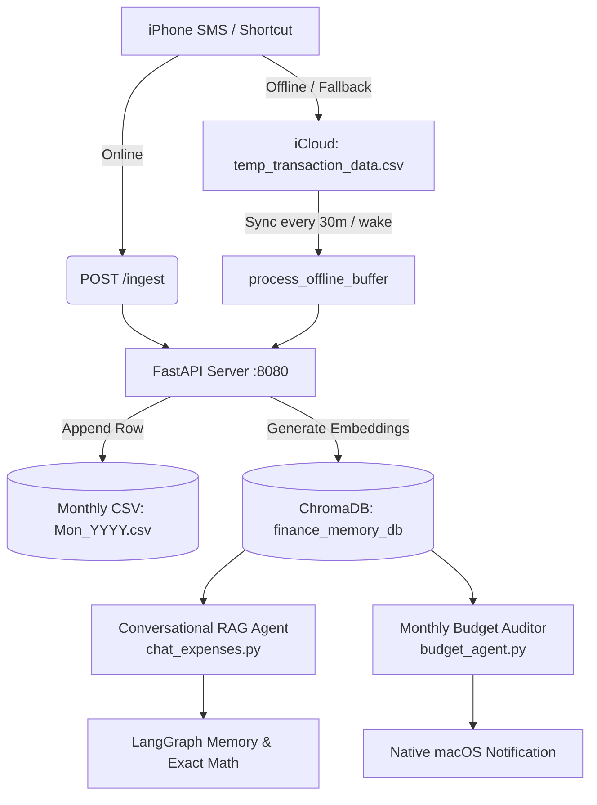

# Expense Agent: Autonomous AI-Powered Personal Finance & RAG Assistant

A local-first, privacy-focused personal finance agent built with **FastAPI**, **LangChain/LangGraph**, **ChromaDB**, and **OpenAI**. 

This system integrates directly with **iOS Shortcuts** for real-time transaction logging from SMS alerts, provides conversational expense insights via an agentic RAG pipeline, audits monthly budgets with push notifications, and handles offline logging with an automatic iCloud Drive sync buffer.

---

## 📑 Table of Contents

- [Architecture Overview](#-architecture-overview)
- [Key Features](#-key-features)
- [Repository Structure](#-repository-structure)
- [Tech Stack](#-tech-stack)
- [Setup & Installation](#-setup--installation)
- [Environment Configuration](#-environment-configuration)
- [API Endpoints](#-api-endpoints)
- [iOS Shortcuts & Offline Sync Pipeline](#-ios-shortcuts--offline-sync-pipeline)
- [Monthly Budget Agent](#-monthly-budget-agent)
- [RAG Evaluation Framework](#-rag-evaluation-framework)
- [Running as a Background Daemon (macOS)](#-running-as-a-background-daemon-macos)
- [Security & Network Isolation](#-security--network-isolation)

---

## 🏗 Architecture Overview


---

## 🌟 Key Features

1. **Sub-Second Real-Time Ingestion (`/ingest`):** Parse bank and credit card SMS notifications directly on iOS and log them to master monthly CSVs in iCloud Drive with real-time vector embeddings.
2. **Resilient Offline Sync:** If the server is unreachable (e.g., MacBook lid closed or away from home), iOS Shortcuts appends transactions to a local `temp_transaction_data.csv` in iCloud. A background loop automatically drains and merges the buffer once reconnected.
3. **Hybrid RAG & Deterministic Math Engine:** Avoids LLM arithmetic errors by combining semantic vector search (ChromaDB) for merchant queries with deterministic Python computation for `max`, `min`, category totals, and monthly aggregations.
4. **Autonomous Monthly Audit Agent (`budget_agent.py`):** Runs an agentic audit comparing month-over-month spending against customizable threshold limits, writes historical summaries to long-term memory, and dispatches native macOS notifications.
5. **Continuous RAG Evaluation (`evaluate_rag.py`):** Includes an LLM-as-a-Judge benchmark suite grading Faithfulness, Answer Relevance, Numeric Accuracy, and Retrieval Quality out of 10.0.
6. **Token Limiter & Session Memory:** Maintains multi-turn context using LangGraph's `MemorySaver` while automatically summarizing and trimming historical messages to prevent context window explosion.

---

## 📁 Repository Structure

```text
.
├── .gitignore               # Excludes virtual environments, .env, and local ChromaDB files
├── budget_agent.py          # Autonomous monthly audit agent & push notification runner
├── chat_expenses.py         # Conversational RAG agent with hybrid search & memory management
├── evaluate_rag.py          # LLM-as-a-Judge RAG evaluation benchmark suite
├── ingest_transactions.py   # iCloud CSV watcher, deduplicating MD5 hasher & ChromaDB sync
├── requirements.txt         # Project dependencies
├── server.py                # FastAPI REST API with rate limiting, lifespan workers & endpoints
├── start_server.sh          # Shell wrapper for background startup and environment setup
└── test_delete.py           # Test utility for wiping and testing database states
```

---

## 🛠 Tech Stack

- **Framework:** FastAPI, Uvicorn, Pydantic v2
- **Agent Framework:** LangChain, LangGraph, `MemorySaver`
- **Vector Database:** ChromaDB (`langchain-chroma`)
- **LLM & Embeddings:** OpenAI `gpt-4o-mini`, `gpt-4o`, `text-embedding-3-small`
- **Rate Limiting:** SlowAPI
- **Networking & Security:** Tailscale (WireGuard CGNAT), Custom Header Authentication

---

## 🚀 Setup & Installation

### 1. Prerequisites
- macOS (recommended for native iCloud Drive integration)
- Python 3.10+
- OpenAI API Key

### 2. Clone and Setup Environment
```bash
git clone <your-repo-url>
cd expense-agent

# Create and activate virtual environment
python3 -m venv venv
source venv/bin/activate

# Install dependencies
pip install -r requirements.txt
```

### 3. Environment Configuration
Create a .env file in the root directory:
```
OPENAI_API_KEY=sk-proj-your-openai-api-key
API_SECRET_KEY=your_secure_random_api_key_for_shortcuts
```
