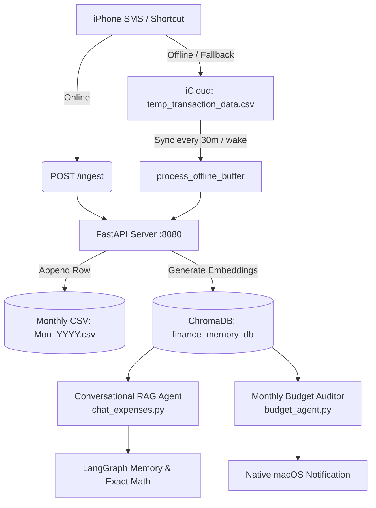

# Expense Agent: Autonomous AI-Powered Personal Finance & RAG Assistant

A privacy-focused, local-first personal finance agent built with **FastAPI**, **LangChain/LangGraph**, **ChromaDB**, and **OpenAI**. It enables real-time and offline expense logging, conversational insights, monthly audits, and robust evaluation—all running on your own device.

---

## Table of Contents

- Architecture Overview
- Key Features
- Repository Structure
- Tech Stack
- Setup & Installation
- Environment Configuration
- API Endpoints
- iOS Shortcuts & Offline Sync
- Monthly Budget Agent
- RAG Evaluation Framework
- Security & Network Isolation

---

## 🏗 Architecture Overview



---

## 🌟 Key Features

1. **Real-Time Ingestion:** Parse and log SMS-based bank/credit card notifications instantly via iOS Shortcuts and `/ingest` API.
2. **Offline Sync:** Transactions are buffered to iCloud when offline and merged automatically when the server is available.
3. **Hybrid RAG & Math Engine:** Combines semantic vector search (ChromaDB) with deterministic Python math for accurate financial queries.
4. **Autonomous Monthly Audit:** Agentic audit of spending, customizable thresholds, historical summaries, and native macOS notifications.
5. **Conversational Insights:** Chat with your expense data using a LangChain/LangGraph-powered agent with memory and token management.
6. **Continuous RAG Evaluation:** LLM-as-a-Judge suite benchmarks faithfulness, relevance, numeric accuracy, and retrieval quality.
7. **Secure & Isolated:** API key authentication, rate limiting, and optional Tailscale VPN for network isolation.

---

## 📁 Repository Structure

```
.
├── src/
│   ├── server.py                  # FastAPI REST API, background workers, endpoints
│   ├── agents/
│   │   ├── chat_expenses.py       # Conversational RAG agent, hybrid search, memory
│   │   └── budget_agent.py        # Monthly audit agent, notifications
│   ├── evaluation/
│   │   └── evaluate_rag.py        # RAG evaluation suite
│   └── util/
│       ├── ingest_transactions.py # iCloud CSV watcher, deduplication, ChromaDB sync
│       └── delete_transaction_data.py # Utilities for deleting transactions
├── finance_memory_db/             # ChromaDB vector store
├── logs/                          # Log files for server, backup, budget
├── requirements.txt               # Python dependencies
├── start_server.sh                # Shell script for server startup
└── README.md                      # Project documentation
```

---

## 🛠 Tech Stack

- **Framework:** FastAPI, Uvicorn, Pydantic v2
- **Agent Framework:** LangChain, LangGraph, MemorySaver
- **Vector Database:** ChromaDB (`langchain-chroma`)
- **LLM & Embeddings:** OpenAI (`gpt-4o-mini`, `gpt-4o`, `text-embedding-3-small`)
- **Rate Limiting:** SlowAPI
- **Scheduling:** Asyncio background tasks
- **Networking & Security:** Tailscale (WireGuard), API key authentication

---

## 🚀 Setup & Installation

### 1. Prerequisites

- macOS (recommended for iCloud integration)
- Python 3.10+
- OpenAI API Key

### 2. Clone and Setup Environment

```bash
git clone <your-repo-url>
cd expense-report-agent
python3 -m venv venv
source venv/bin/activate
pip install -r requirements.txt
```

### 3. Environment Configuration

Create a `.env` file in the root directory:

```
OPENAI_API_KEY=sk-proj-your-openai-api-key
API_SECRET_KEY=your_secure_random_api_key_for_shortcuts
BASE_ICLOUD_DIR=/path/to/your/iCloud/Expense_DB_Backups
SHORTCUTS_APP_CONTAINER_PATH=/path/to/Shortcuts/iCloud/container
```

---

## 🔌 API Endpoints

- `POST /ingest`: Log a single transaction (used by iOS Shortcuts).
- `POST /chat`: Conversational interface for querying expenses.
- `POST /delete`: Remove transactions by ID.
- `GET /status`: Health check endpoint.

All endpoints require an `x-api-key` header for authentication.

---

## 📱 iOS Shortcuts & Offline Sync

- **Online:** iOS Shortcut sends transaction data to `/ingest`.
- **Offline:** Shortcut appends to `temp_transaction_data.csv` in iCloud. The server merges and processes this buffer automatically every 30 minutes or on wake.

---

## 📊 Monthly Budget Agent

- Runs periodic audits of your monthly spending.
- Compares against customizable thresholds.
- Writes summaries to long-term memory and sends native macOS notifications.

---

## 🧪 RAG Evaluation Framework

- Evaluates the RAG pipeline using LLM-as-a-Judge.
- Benchmarks faithfulness, answer relevance, numeric accuracy, and retrieval quality.
- Uses OpenAI models for unbiased scoring.

---

## 🔒 Security & Network Isolation

- API key authentication for all endpoints.
- Rate limiting to prevent abuse.
- Optional Tailscale VPN for secure remote access.

---

